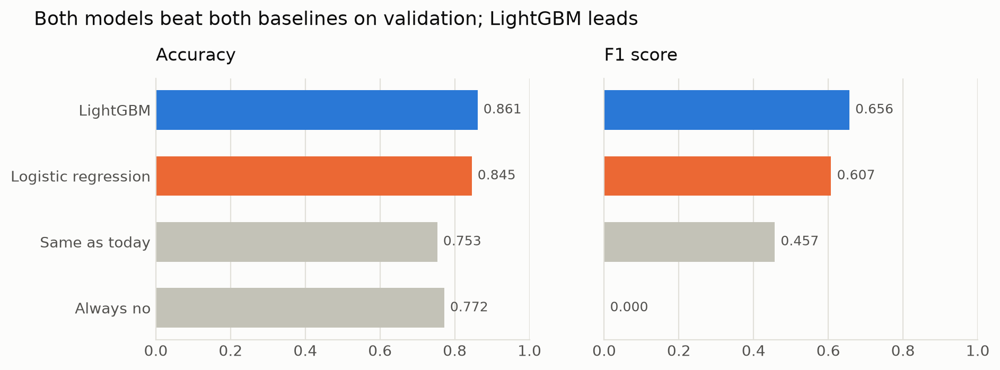
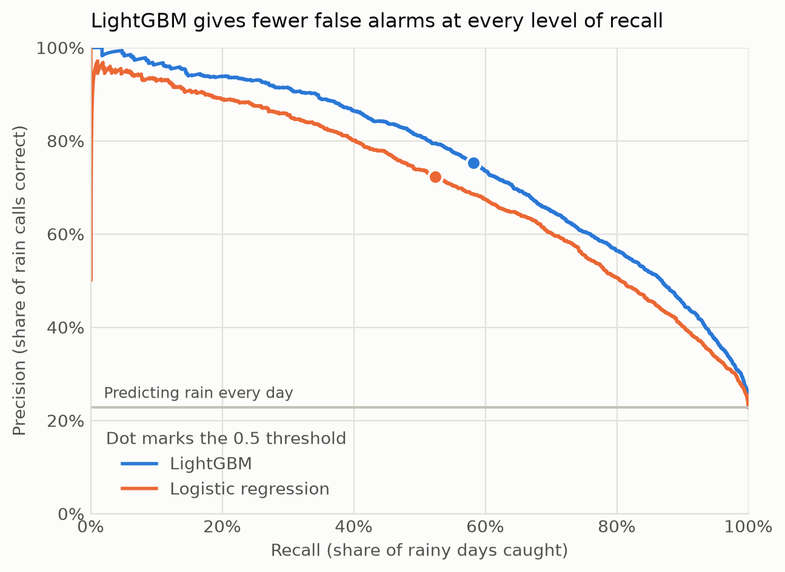
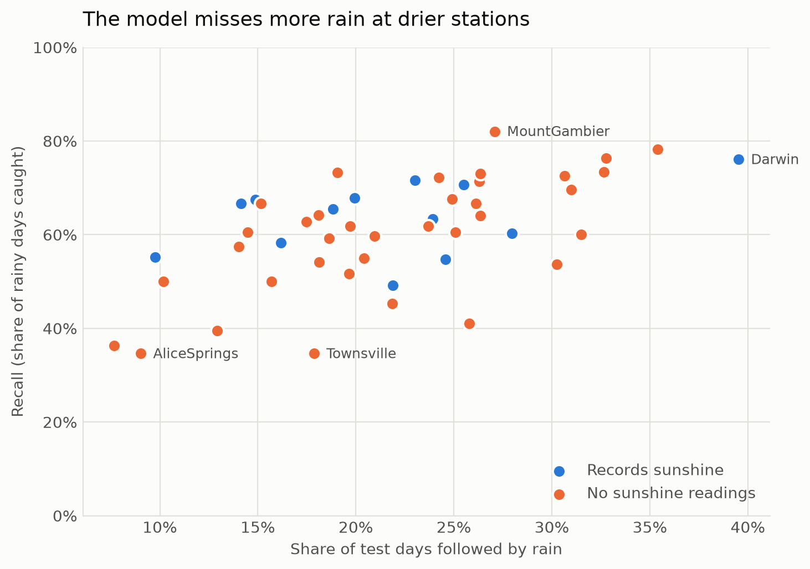
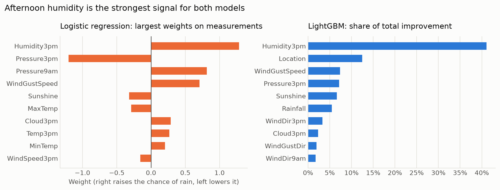

# Will it rain tomorrow? Rain prediction for 49 Australian weather stations

Given one day of ground readings at a weather station (temperature, humidity, pressure, wind, cloud), can a model say whether it will rain there tomorrow better than a guess that needs no learning?

**Short answer: yes.** On ten months the model never saw, LightGBM scores 0.856 accuracy and F1 0.656. Always guessing "no rain" scores 0.782 accuracy and catches no rain at all; assuming tomorrow matches today scores F1 0.430.



## Data

| | |
|---|---|
| Source | [Rain in Australia](https://www.kaggle.com/datasets/jsphyg/weather-dataset-rattle-package) (Kaggle), daily observations from the Australian Bureau of Meteorology |
| Target | `RainTomorrow`: did more than 1 mm of rain fall the next day? |
| Rows | 145,460 station-days; 3,267 have no target and are dropped, leaving 142,193 |
| Stations | 49 |
| Period | 1 November 2007 to 25 June 2017 |
| Class balance | 22.4% of days are followed by rain |
| Predictors | 16 measurements (temperature, rainfall, evaporation, sunshine, wind speed, humidity, pressure, cloud), 3 wind directions, `RainToday`, station, month |

One row is one day at one station.

## Method

**1. Look at the data** ([notebook 01](NOTEBOOKS/01_data.ipynb)).

- Rain rate varies far more by station (6.8% at Woomera to 36.5% at Portland) than by month (19.3% in January to 26.9% in July).
- Four columns are missing for 38% to 48% of rows: Sunshine, Evaporation, Cloud9am and Cloud3pm. The gaps are not random. They follow station equipment: 19 of the 49 stations have no Sunshine reading at all.
- Sunshine is also the single column that best separates rainy from dry days, so the strongest signal is absent for a large part of the data.

**2. Check for leakage before splitting** ([notebook 02](NOTEBOOKS/02_checks.ipynb)).

- `RainTomorrow` is exactly the next day's `RainToday` at the same station (142,017 consecutive day-pairs, 100% match). Every predictor is measured on the day itself, so no column gives away the answer.
- Neighbouring days at a station are near-copies of each other. A random split would put Tuesday in training and Wednesday in test and flatter the score.
- So the split is by date, with one cut-off shared by all stations:

| Split | Rows | From | To | Rain rate |
|---|---|---|---|---|
| Train | 113,796 | 2007-11-01 | 2015-11-10 | 22.4% |
| Validation | 14,184 | 2015-11-11 | 2016-09-01 | 22.8% |
| Test | 14,213 | 2016-09-02 | 2017-06-25 | 21.8% |

**3. Set the bar with baselines** ([notebook 03](NOTEBOOKS/03_baselines.ipynb)). Two guesses that involve no learning: always predict "no rain", and predict that tomorrow matches today. A model has to beat the first on accuracy and the second on F1.

**4. Fit two models** ([notebook 04](NOTEBOOKS/04_models.ipynb)).

- **Logistic regression.** Missing numbers are filled with the training median and a 0/1 "was missing" column is added for each, so the model keeps the information that a station doesn't record something. Numbers are standardised; station, wind direction, `RainToday` and month are one-hot encoded.
- **LightGBM** (500 trees, learning rate 0.05). It is given the raw columns with the gaps left in, since trees handle missing values and categories directly.

**5. Choose a threshold, then score the test set once** ([notebook 05](NOTEBOOKS/05_evaluation.ipynb)). The cut-off for calling "rain" is chosen on validation and fixed before the test set is touched.

## Results

### Validation: both models beat both baselines

| Model | Accuracy | Precision | Recall | F1 |
|---|---|---|---|---|
| Always no | 0.772 | 0.000 | 0.000 | 0.000 |
| Same as today | 0.753 | 0.459 | 0.454 | 0.457 |
| Logistic regression | 0.845 | 0.722 | 0.524 | 0.607 |
| **LightGBM** | **0.861** | **0.753** | **0.582** | **0.656** |

Accuracy alone is misleading here. "Always no" reaches 0.772 without predicting a single rainy day, and it beats "same as today" on accuracy while being useless as a forecast. That is why F1, precision and recall are reported alongside it.

### LightGBM is better at every threshold

Each point on a line is the same model with a different cut-off for calling "rain". Lowering the cut-off catches more rain and raises more false alarms.



LightGBM's line sits above logistic regression's along its whole length, so its lead does not depend on where the threshold is set. Training with balanced class weights moves a model along its line (LightGBM: recall 0.782, precision 0.586) without lifting the line.

### Choosing the threshold

| Threshold | Accuracy | Precision | Recall | F1 |
|---|---|---|---|---|
| 0.2 | 0.806 | 0.550 | 0.816 | 0.657 |
| 0.3 | 0.838 | 0.624 | 0.729 | 0.673 |
| **0.4** | **0.854** | **0.691** | **0.656** | **0.673** |
| 0.5 | 0.861 | 0.753 | 0.582 | 0.656 |
| 0.6 | 0.860 | 0.806 | 0.509 | 0.624 |
| 0.7 | 0.851 | 0.853 | 0.417 | 0.560 |

F1 peaks between 0.3 and 0.4 on validation. 0.4 was chosen: the same F1 as 0.3 with fewer false alarms. A use where missed rain is the costly mistake would pick a lower value.

### Test: the final number

| Model | Accuracy | Precision | Recall | F1 |
|---|---|---|---|---|
| Always no | 0.782 | 0.000 | 0.000 | 0.000 |
| Same as today | 0.753 | 0.433 | 0.427 | 0.430 |
| **LightGBM at 0.4** | **0.856** | **0.682** | **0.631** | **0.656** |

When the model says rain it is right about 68% of the time, and it catches about 63% of rainy days. F1 is 0.017 below validation at the same threshold (0.673), a small drop of the size expected when the threshold was picked on validation.

### Where it goes wrong



The overall recall of 0.631 hides a range from 0.35 (Alice Springs, Townsville) to 0.82 (Mount Gambier). Recall rises with how often it rains at a station (correlation 0.58): the model misses most of the rain at dry stations, where it had few rainy days to learn from. Whether a station records Sunshine makes little difference (average recall 0.636 with readings, 0.600 without).

### What the models rely on



The two panels use different units, so compare the order of the bars, not their lengths across panels.

- Afternoon humidity is the strongest signal for both models. In LightGBM it accounts for 41% of the total error reduction.
- Logistic regression gives 3pm pressure a strong negative weight and 9am pressure a positive one. Together they say that pressure falling during the day means rain.
- Station is second for LightGBM (12%), which matches the spread in rain rate between stations.
- Sunshine best separated rainy from dry days one column at a time, but ranks fifth in both models, consistent with it being missing at many stations.

## Conclusions

- **A model built from one day of ground readings clearly beats no-learning guesses**, by 7.4 points of accuracy over "always no" and 0.226 F1 over "same as today" on unseen data.
- **Most of the signal is simple.** Logistic regression reaches F1 0.607 on validation; LightGBM adds about 0.05 by picking up combinations of features and patterns in what is missing.
- **The threshold is a choice about which mistake costs more**, not a property of the model. Moving it from 0.5 to 0.4 raised validation recall from 0.582 to 0.656 with no retraining.
- **One overall score is not enough.** The model is much weaker at dry stations, which an average across all 49 conceals.

## Limitations

- **No tuning.** Both models use fixed settings. LightGBM scores F1 0.734 on its training rows against 0.656 on validation, so it overfits somewhat.
- **Short evaluation periods.** Validation and test each cover about ten months and different seasons. The test period has no July or August, the wettest months.
- **Noisy per-station figures.** Each station has between 22 and 117 rainy days in the test period, so a single station's recall can move several points on a handful of days.
- **The data changes over time.** Only 13 stations record Sunshine in the test period, fewer than in earlier years, so the model is tested on stations reporting less than they did in training.
- **Known stations only.** Every station appears in training, so these scores say nothing about a station the model has never seen.
- **Ground readings only.** Operational forecasts use physical atmosphere models with satellite and radar data, which this dataset does not contain.

## Reproduce

```bash
pip install -r requirements.txt
```

Download `weatherAUS.csv` from the [Kaggle dataset page](https://www.kaggle.com/datasets/jsphyg/weather-dataset-rattle-package) and place it at `data.raw/weatherAUS.csv`. The data is not committed (`data.raw/` is git-ignored).

Then run the notebooks in `NOTEBOOKS/` in order, `01_data` to `05_evaluation`. Notebooks 04 and 05 write the charts above to `figures/`. Built with Python 3.13, scikit-learn 1.9.1 and LightGBM 4.7.0.
